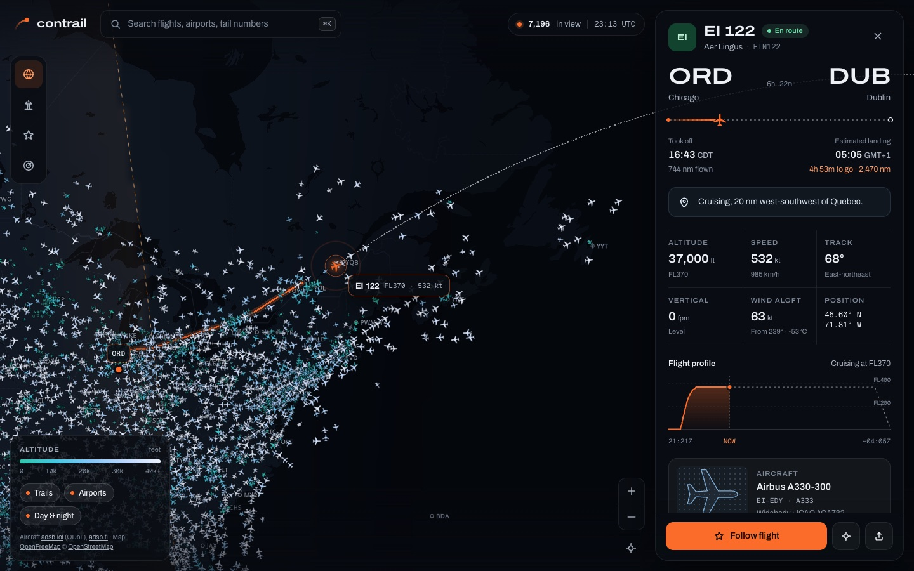
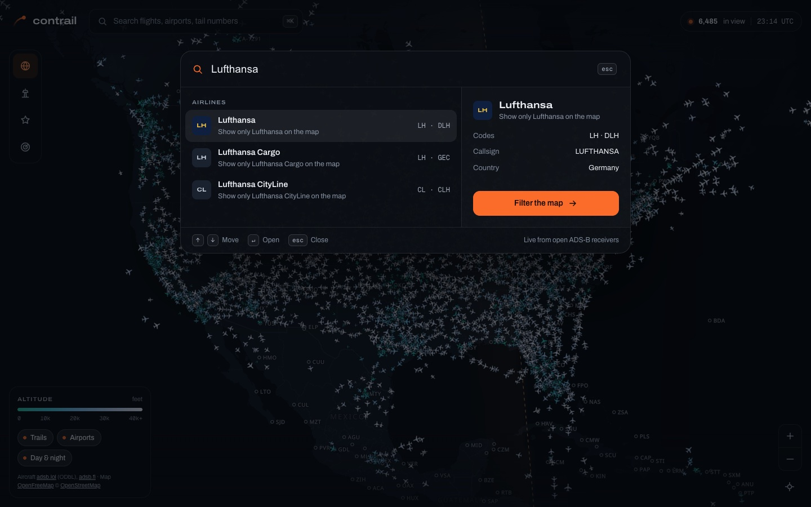
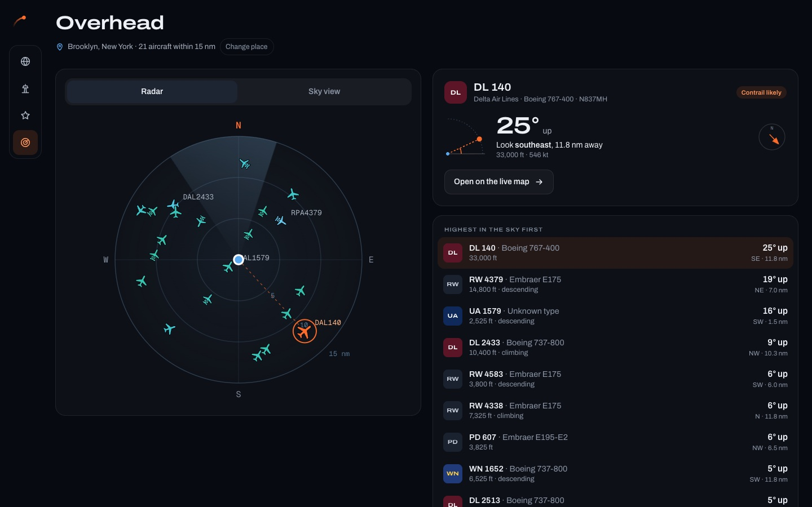
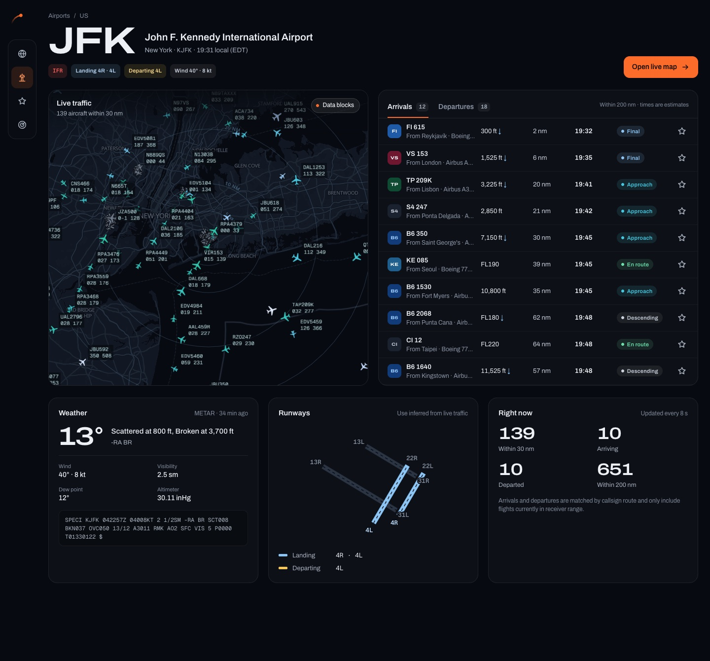
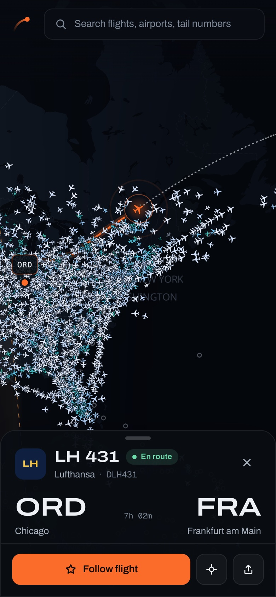

# Contrail — the sky, live

A free, live flight tracker built on open ADS-B data. Contrail shows every aircraft that community receivers can hear, follows any flight from takeoff to landing, tells you exactly where to look for the plane overhead, and turns airport traffic into a live approach radar. It costs nothing to run.



<p>
  
  
</p>
<p>
  
  
</p>

## What it does

- **Live map.** Thousands of aircraft move smoothly between updates (dead reckoning). Each one has a type-specific silhouette, and colour encodes altitude, teal near the ground to ice-white at cruise. The map shades the real day/night terminator and marks the sunset and sunrise lines.
- **Flight detail.** Select any aircraft to see:
  - its route, progress and estimated landing time in the destination's local time zone
  - its real flown path and live altitude profile
  - live telemetry: altitude, speed, track, vertical rate and wind aloft
  - a short plain-language summary, such as "Chasing the sunset over the North Atlantic, 330 nm northeast of St. John's"
  - a photo of the aircraft (with credit) and the weather at the destination
- **Search (⌘K or /).** Find flight numbers (`BA 117`), callsigns (`UAL901`), tail numbers (`G-XLEL`), airports and airlines. Special searches cover every A380 in the air, military traffic, and emergencies (squawk 7700).
- **Following.** Follow flights and keep them in a dock, with progress and time remaining. Optional browser alerts fire on takeoff, start of descent and landing while the app is open.
- **Overhead.** Uses your location to find everything within 15 nm. It shows a radar, a sky chart, and a plain instruction such as "Look 19° up to the north-northeast". It also flags when a high aircraft is likely to leave a contrail, using upper-air humidity and temperature.
- **Airports.** Any airport gets:
  - a live approach radar with controller-style data blocks
  - arrival and departure boards
  - decoded METAR weather
  - a runway diagram, with the runways in use worked out from live traffic
- **Phones.** A tab bar, a bottom-sheet flight panel, and an installable web app manifest.

## How it works

```
Browser ──► Next.js route handlers (/api/*) ──► adsb.lol / adsb.fi   live positions, traces
   │          shared in-memory cache,         adsbdb / hexdb        callsign → route
   │          CDN cache headers,              planespotters.net     aircraft photos (metadata)
   │          rate-limit cooldown + fallback  aviationweather.gov   METAR
   │
   ├──► OpenFreeMap vector tiles (MapLibre GL)
   ├──► Open-Meteo (weather, time zones, upper-air data)
   └──► Planespotters image CDN (photos are hotlinked with credit, never proxied)
```

- **Rendering.** MapLibre GL draws the basemap. deck.gl draws aircraft, trails and paths as GPU layers. Positions are dead-reckoned about 30 times a second between 10-second updates.
- **Fetching traffic.** The client asks for a circle that covers the viewport. The server snaps the centre and radius to a coarse grid, so nearby viewers share one upstream request. It also caches each answer for a few seconds.
- **Rate limits.** When adsb.lol rate-limits, the server stops calling it for a short cooldown. Meanwhile it serves recent data from a cached circle that covers the same area, and falls back to adsb.fi for areas under 250 nm.
- **Route sanity checks.** A route is shown only if the aircraft's position fits it. When the trace starts on the ground, the takeoff must also have been at the published origin.

## Run it locally

```bash
npm install
npm run dev
```

Open http://localhost:3000. Optional environment variables are listed in `.env.example`.

The bundled reference data can be refreshed at any time:

```bash
node scripts/build-data.mjs   # airports + runways (OurAirports), airlines (OpenFlights)
node scripts/build-style.mjs  # basemap style derived from OpenFreeMap "dark"
```

## Deploy for free

1. Push this repository to GitHub.
2. Import it on [Vercel](https://vercel.com/new). The Hobby plan is free for personal, non-commercial projects. No build settings are needed.
3. Optionally, set `CONTRAIL_CONTACT` to a URL or email. Free data providers like to know who is calling.

Any Node host that runs Next.js works too, for example Netlify, Render or a small VPS. The app needs no database and no API keys.

## Honest limitations

- **No ocean coverage.** ADS-B receivers are on land, with a range of about 250 nm, and the free feeds have no satellite data. Planes vanish mid-ocean. A selected flight keeps moving along its route and is clearly marked as an estimate.
- **Routes are a best guess.** Routes come from callsign databases and can be out of date. Contrail hides any route that contradicts the aircraft's own track.
- **No schedules, gates or delays.** That data is paid. Arrival times here are estimates from live speed and distance.
- **Alerts only while open.** Alerts run while a tab is open, because there is no push server.
- **Non-commercial use only.** The terms of most of these free data sources require it.

## Data and credits

| Source | Used for | Terms |
| --- | --- | --- |
| [adsb.lol](https://adsb.lol) | Live positions, flight traces | ODbL; credit required |
| [adsb.fi](https://adsb.fi) | Fallback live positions | Personal, non-commercial; credit required |
| [adsbdb](https://www.adsbdb.com) · [hexdb.io](https://hexdb.io) | Callsign → route | Free; don't bulk-copy |
| [Planespotters.net](https://www.planespotters.net) | Aircraft photos | Photographer credit and link; images hotlinked |
| [OpenFreeMap](https://openfreemap.org) · [OpenStreetMap](https://www.openstreetmap.org/copyright) | Basemap tiles, fonts | © OpenMapTiles, © OpenStreetMap contributors |
| [OurAirports](https://ourairports.com/data/) | Airports, runways | Public domain |
| [OpenFlights](https://openflights.org/data) | Airline codes and names | ODbL |
| [Open-Meteo](https://open-meteo.com) | Weather, time zones, upper air | CC BY 4.0, non-commercial |
| [aviationweather.gov](https://aviationweather.gov/data/api/) | METAR | US government, public domain |

## Project structure

```
src/app/                 routes: / (live map), /airport/[code], /overhead, /following, /api/*
src/components/map/      MapController (MapLibre + deck.gl engine), MapView, icon atlas
src/components/panel/    flight panel, altitude profile, progress bar, aircraft blueprint
src/components/search/   ⌘K command palette
src/components/airport/  airport radar and boards
src/components/overhead/ overhead radar and sky chart
src/lib/                 geometry, sun position, formatting, store, data hooks, narrative text
src/lib/server/          upstream clients, cache, response helpers (server only)
scripts/                 reference data and map style builders
```
